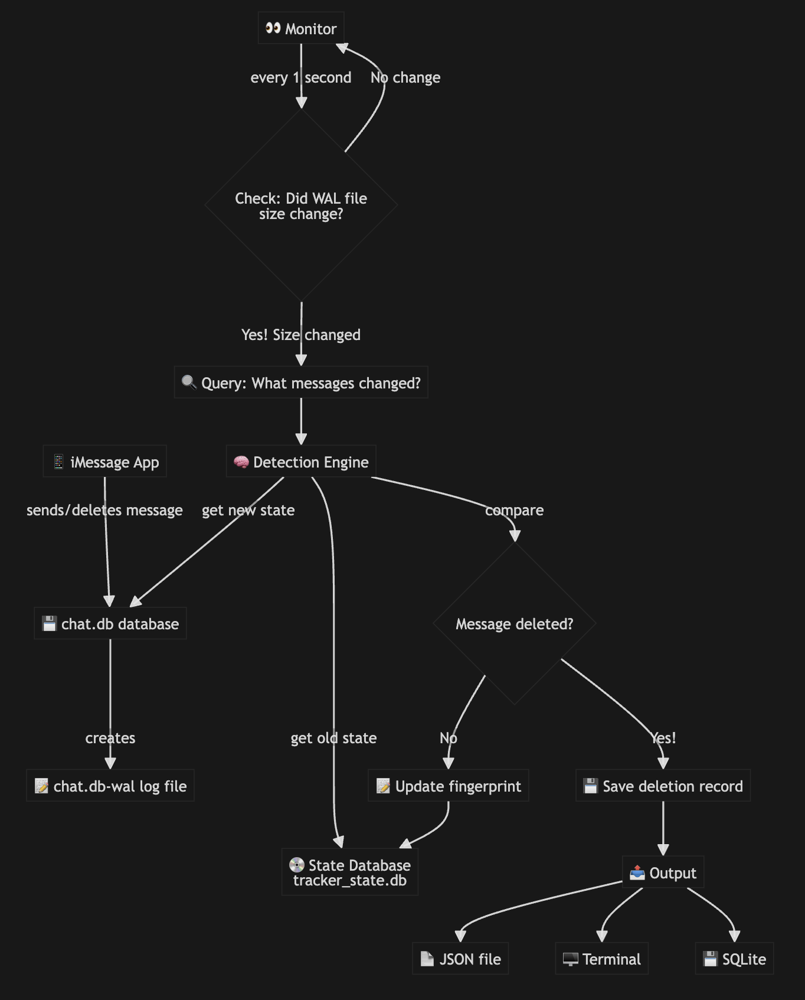

# 🕵️ iMessage EDA Tracker

Efficient monitor that detects and preserves deleted iMessages using WAL file monitoring.

> This project is an enhanced fork of [this repo](https://github.com/ArcherHeffern/iMessage-undeleter-rust), which itself builds on [ReagentX/imessage-exporter](https://github.com/ReagentX/imessage-exporter)'s `imessage-database` library

## 🎯 What It Does

Detects deleted/edited messages:

- 📱 **Message content** - Full text with formatting
- 🖼️ **Attachments** - Images, videos, files
- 👤 **Contact info** - Sender/receiver details
- ⏰ **Timestamps** - Send and deletion times



## 🏗️ How it works?

### Architecture Overview

The system uses **WAL monitoring** with an event-style processing pipeline:

1. **WAL Size Polling** (every 1000ms): Checks `chat.db-wal` file size
2. **Change Detection**: If WAL size changed → queries database for modified messages
3. **Fingerprint Comparison**: Compares previous state (from state DB) vs current state (from iMessage DB)
4. **Deletion Detection**: Detects when message content transitions from non-empty → empty
5. **State Persistence**: Stores fingerprints in SQLite for restart resilience
6. **Output**: Writes to JSON, SQLite, terminal, or webhooks via async streams

## ✨ Improvements Over Original

### Performance
- **WAL file monitoring**: Checks file metadata (~0.1ms) instead of querying database every 500ms
- **Conditional queries**: Only queries database when WAL size changes (not continuously)
- **~Way less CPU** when idle: a db query is roughly 10–100× more expensive than checking the WAL file
- **Async streams**: Better concurrency

### Reliability
- **Persistent state**: Saves message fingerprints to SQLite (`tracker_state.db`), survives restarts
- **Detects deletions that happened while app was offline**: Compares stored fingerprints on startup
- **State management**: Tracks message history even after crashes

## How to run?

### 1. Enable Full Disk Access (Required)

1. Open **System Settings** → **Privacy & Security** → **Full Disk Access**
2. Add your terminal application
3. Restart terminal

### 2. Verify Permissions

Test that permissions work:
```bash
ls -la /Users/$USER/Library/Messages/
```

**Failure**: "Operation not permitted" - repeat step 1

### 3. Run the Monitor

Navigate to the tracker directory first:
```bash
cd imessage-eda-tracker/imessage-undeleter
```

**Basic usage:**
```bash
# Start monitoring all conversations
cargo run
```